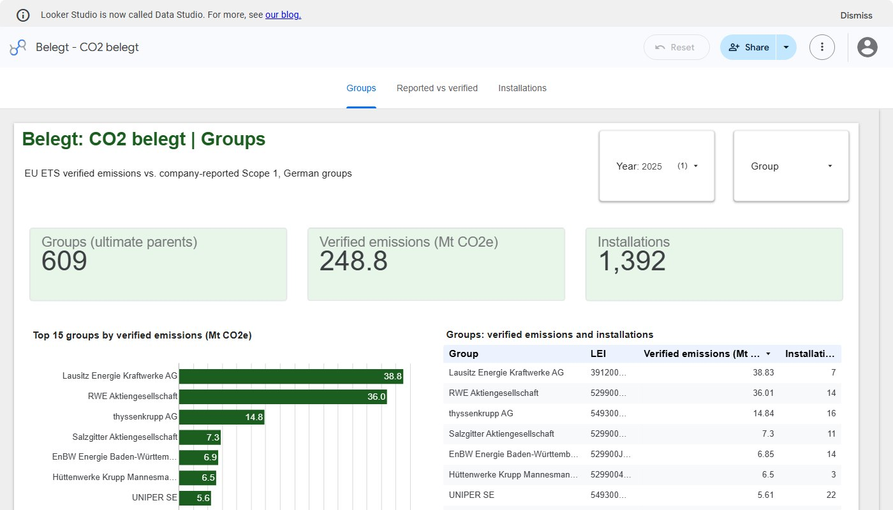
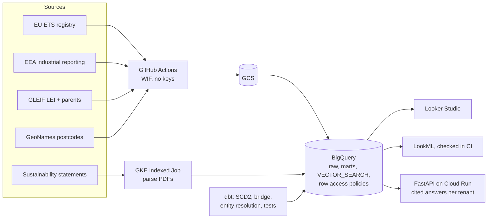
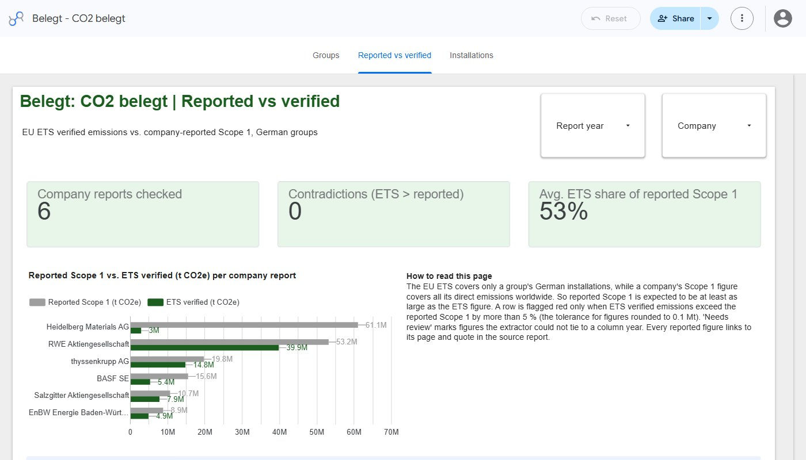
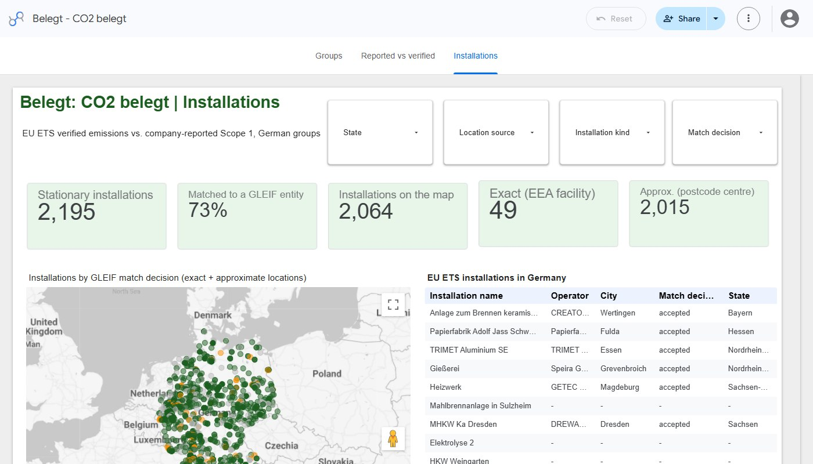

# Belegt

[](https://github.com/Parsaka/belegt/actions/workflows/ci.yml)
[](https://github.com/Parsaka/belegt/actions/workflows/pipeline.yml)
[](https://github.com/Parsaka/belegt/actions/workflows/k8s.yml)

Sustainability data for German companies, with every number traceable to its source.

Belegt links the verified CO₂ emissions of individual installations in the EU Emissions Trading
System to the companies that own them (through GLEIF ownership data). It also extracts the
figures companies publish in their sustainability statements, citing the page, and flags
inconsistencies between the two. A multi-tenant assistant answers questions with citations, and
it declines to answer when the documents do not contain the answer.

A personal portfolio project (Parsa Kamali). Not investment, audit or legal advice.

## Explore

| | |
|---|---|
| **Project page** | [parsaka.github.io/belegt](https://parsaka.github.io/belegt/): the motivation, the architecture, the deep dives and every measured result on one page |
| **Dashboard** | [Looker Studio report](https://lookerstudio.google.com/reporting/8653329c-9086-4395-9526-c577d32895fb): groups, reported vs verified, installations map ([about it](docs/dashboard.md)) |
| **Data model** | [ERD and modelling decisions](docs/erd.md) · [dbt docs with lineage](https://parsaka.github.io/belegt/dbt/) |
| **Measured results** | [Production run](docs/measurements/production.md) · [full data](docs/measurements/full-data.md) · [entity resolution](docs/measurements/entity-resolution.md) · [extraction accuracy](docs/measurements/extraction.md) · [assistant on reports](docs/measurements/assistant-reports.md) |
| **Decisions** | [ADRs](docs/adr/) · [budget](docs/budget.md) · [data sources and licences](docs/data-sources.md) |



## Results (measured on Google Cloud)

| What | Result |
|---|---|
| German stationary ETS installations | 2,195; 77.3 % matched to a GLEIF company, 91.7 % of 2025 verified tonnage attributed to a group |
| Installations on the map | 2,064 of 2,195 (49 exact EEA points, 2,015 at the contact-postcode centre) |
| dbt on BigQuery | 65 of 65 nodes pass on the full data (models, seeds, SCD2 snapshot, tests) |
| Sustainability statements | Scope 1-3 extraction on 37 DAX/MDAX reports against 148 hand labels: 82.7 % precision, 70.5 % recall; 80.8 % precision on the 22 held-out reports ([method](docs/measurements/extraction.md)) |
| Parsing at scale | 37 of 37 reports parsed in parallel by a Kubernetes Indexed Job on GKE Autopilot ([run 41249255988](https://github.com/Parsaka/belegt/actions/runs/41249255988)); Scope 1 checked against the ETS sum per group |
| Document assistant | On 37 real reports: 19 of 31 Scope 1 questions answered with the printed figure and a citation on the right page, 31 of 31 cross-tenant questions declined, 0 leaks ([method](docs/measurements/assistant-reports.md)) |
| API on Cloud Run | 3.34 s cold, 1.33 s warm (min 0, max 1 instances) |
| Cost | October 2026: 0.00 EUR net (all usage covered by the trial credit); hard cap 1.00 EUR per month |
| Kill switch | Drill confirms it would detach billing (`WOULD DETACH`) |

Sources: [production.md](docs/measurements/production.md), [full-data.md](docs/measurements/full-data.md), [extraction.md](docs/measurements/extraction.md),
weekly cost report on the `ops-results` branch.



## How it fits together

| Layer | Tool | Job |
|---|---|---|
| Ingest | Python (`belegt extract`, `belegt reports`) | Download the registries and reports, parse them, keep a manifest with checksums |
| Warehouse | BigQuery (DuckDB locally and in CI) | Raw tables, loaded idempotently |
| Models | dbt | Star schema, SCD2 legal entities, time-bounded ownership bridge, entity resolution, consistency checks |
| Parallel work | Kubernetes Indexed Job (GKE during the trial), Cloud Run job afterwards | One task per sustainability statement; tested on kind in CI |
| Documents | BigQuery `VECTOR_SEARCH`, row access policies | Cited answers per tenant; evals fail CI on any cross-tenant leak |
| Semantic layer | LookML (validated in CI), Looker Studio (public) | Business definitions in code; the [public dashboard](https://lookerstudio.google.com/reporting/8653329c-9086-4395-9526-c577d32895fb) ([no Looker instance](docs/adr/0004-looker-trial-quota.md)) |
| API | FastAPI on Cloud Run (min 0, max 1) | Bearer token per tenant, rate-limited |
| Infra and CI/CD | Terraform, GitHub Actions with Workload Identity Federation | No keys anywhere; every apply is approved |

## Hard budget

At most **1.00 EUR per month**, enforced in Terraform with several layers. See
[docs/budget.md](docs/budget.md). The build runs inside the Google Cloud free trial. Afterwards
only free-tier services stay on, and parts that were switched off are documented with
screenshots and labelled as temporary.

## Data

Every dataset, with its source, licence and terms, is listed in
[docs/data-sources.md](docs/data-sources.md).

## Screenshots

| Groups | Reported vs verified | Installations |
|---|---|---|
|  |  |  |

## Development

```bash
pip install -e ".[dev]"
make lint test
belegt sources        # list the registered data sources and their licences
```
