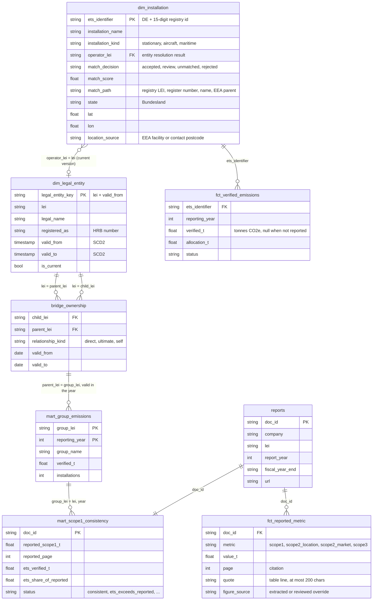

# Data model

The marts in BigQuery (`marts` dataset), as built by dbt. Column lists show the keys and the
columns the dashboard and the consistency check use; the full column docs are in the
[dbt docs](https://parsaka.github.io/belegt/).

## Decisions worth knowing

- **SCD2 on GLEIF entities** (`snap_gleif_entities`): names, addresses and status change; a fact
  joins the version valid at its date.
- **Time-bounded ownership bridge:** "which group owned this plant *in 2022*" is a join on
  `valid_from`/`valid_to` at the year end, not on today's parent. Each entity also has a `self`
  edge, so an operator without a GLEIF parent is its own group.
- **Entity resolution with a review queue:** registry LEI first, then the commercial register
  number against GLEIF `registeredAs`, then the normalised name, then the EEA parent name.
  Uncertain matches go to `review_entity_matches`; human decisions are the seed
  `entity_overrides.csv`, so the matcher never changes silently.
- **Reported vs verified:** ETS covers only EU installations, so reported Scope 1 is normally
  *above* the ETS sum. Only ETS above reported (with a 5 % tolerance) is a hard inconsistency.
